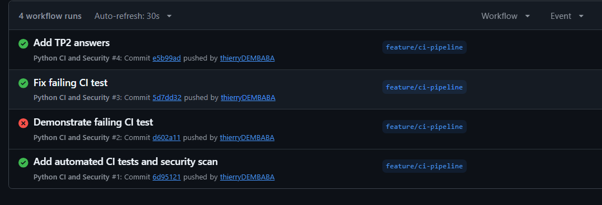
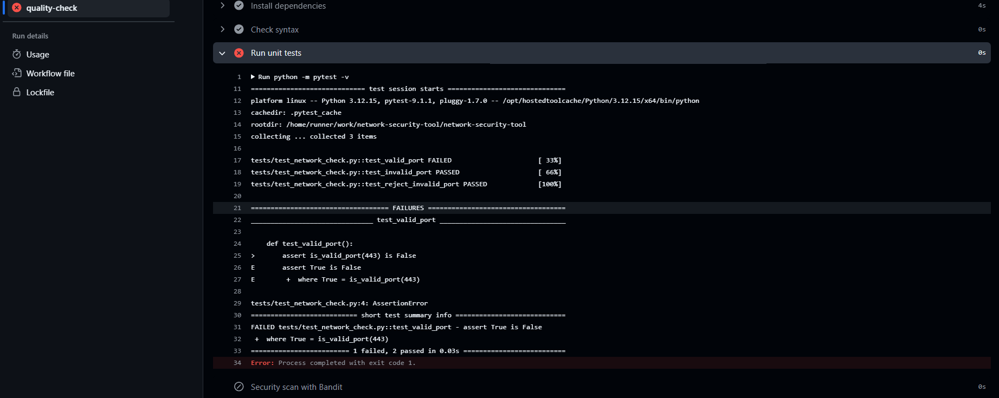

# TP 2 — GitHub Actions : réponses

## Livrables

| # | Livrable | Lien / fichier |
|---|---|---|
| 1 | Dépôt GitHub | https://github.com/thierryDEMBABA/network-security-tool |
| 2 | Pull Request `feature/ci-pipeline` → `main` (fusionnée) | https://github.com/thierryDEMBABA/network-security-tool/pull/2 |
| 3 | Capture d'un pipeline réussi | [assets/img/pipeline-reussi.png](assets/img/pipeline-reussi.png) |
| 4 | Capture du pipeline volontairement échoué | [assets/img/pipeline-echec.png](assets/img/pipeline-echec.png) |
| 5 | Réponses aux cinq questions | Ce fichier (sections ci-dessous) |
| 6 | Fichiers du projet | [network_check.py](network_check.py), [requirements-dev.txt](requirements-dev.txt), [tests/test_network_check.py](tests/test_network_check.py), [.github/workflows/ci.yml](.github/workflows/ci.yml) |

### Pipeline réussi

Historique des runs du workflow *Python CI and Security* : les runs #1, #3 et #4 sont verts. Le run #2 correspond à l'échec volontaire de la partie 5.



### Pipeline volontairement échoué

Run #2, commit `d602a11` *Demonstrate failing CI test* : l'étape **Run unit tests** échoue sur `test_valid_port` (`assert True is False`), et l'étape **Security scan with Bandit** est sautée.



## Question 1 : Pourquoi les tests ne dépendent-ils pas de l'ouverture réelle du port 443 ?

`test_valid_port` et `test_invalid_port` testent uniquement `is_valid_port()`, une fonction de pure logique qui vérifie le type et la plage `1–65535` sans aucun accès réseau.
`test_reject_invalid_port` appelle bien `check_port()`, mais avec un port invalide (70000) : la `ValueError` est levée **avant** la création du socket.
Les tests sont donc **déterministes** : ils donnent le même résultat sur ma machine et sur le runner GitHub, quels que soient les services lancés. Un test unitaire doit vérifier le code, pas l'état de l'environnement.

## Question 2 : Différence entre `push` et `pull_request`

- **`push`** : le workflow se déclenche quand des commits sont poussés sur une branche surveillée (ici `main` et `feature/**`). Il teste le code tel qu'il est sur cette branche.
- **`pull_request`** : le workflow se déclenche quand une PR vers `main` est ouverte ou mise à jour. Il teste le résultat de la **fusion** de la branche avec `main`, et son statut s'affiche dans l'onglet *Checks* de la PR. C'est ce statut qu'on utilise pour autoriser ou bloquer le merge.

## Question 3 : Que se passe-t-il si pytest renvoie un code d'erreur ?

Quand un test échoue, pytest se termine avec un code différent de 0. GitHub Actions considère alors l'étape `Run unit tests` comme **en échec**. Le job s'arrête : les étapes suivantes (`Security scan with Bandit`) sont **sautées** (*skipped*). Le run passe au rouge ❌, et la PR associée affiche un check en échec.

Log observé lors de l'échec volontaire (partie 5) :

```
FAILED tests/test_network_check.py::test_valid_port - assert True is False
Error: Process completed with exit code 1.
```

## Question 4 : Pourquoi bloquer une Pull Request quand les tests échouent ?

- La branche `main` doit toujours rester **stable et déployable**. Un test rouge signale une régression ou un bug.
- Bloquer le merge empêche qu'un code cassé (ou vulnérable) arrive en production, puis sur les branches des autres développeurs.
- C'est un contrôle **automatique et objectif** : il ne dépend pas de la vigilance du relecteur.
- On corrige le problème au moment où il est le moins coûteux, juste après l'avoir introduit.

Pour l'appliquer, on configure une règle de protection de branche sur `main` (*Require status checks to pass before merging*).

## Question 5 : Différence entre le contrôle SAST (Bandit) et les tests pytest

| | pytest (tests fonctionnels) | Bandit (SAST) |
|---|---|---|
| Ce qu'il vérifie | Le code **fait ce qu'il doit faire** (comportement attendu) | Le code ne contient pas de **pratiques dangereuses** connues |
| Méthode | **Exécute** le code avec des entrées et compare les résultats | **Analyse le code source sans l'exécuter** (arbre syntaxique) |
| Exemples | Port 443 valide, port 70000 rejeté | `eval()`, `subprocess(shell=True)`, mots de passe en dur, `pickle`, bind sur `0.0.0.0`… |
| Écrit par | Le développeur, spécifique au projet | Règles génériques fournies par l'outil |

Les deux sont complémentaires : un code peut passer tous les tests tout en étant vulnérable, et inversement.

## Bonus : `python -m compileall -q network_check.py`

J'ai ajouté l'étape `Check syntax` au workflow. Elle **compile le fichier en bytecode** et échoue s'il contient une **erreur de syntaxe** (parenthèse manquante, indentation invalide…). C'est un contrôle rapide qui détecte le code qui ne peut même pas être chargé.

Il ne remplace pas les autres contrôles :
- **pas pytest** : un code syntaxiquement correct peut avoir une logique fausse (ex. `1 <= port <= 6553`). Seuls les tests vérifient le comportement.
- **pas Bandit** : un `eval(input())` est parfaitement valide syntaxiquement. Seule l'analyse de sécurité le signale.
