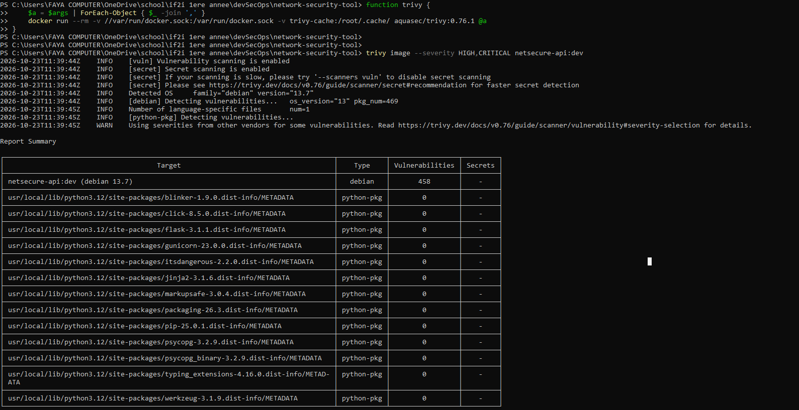
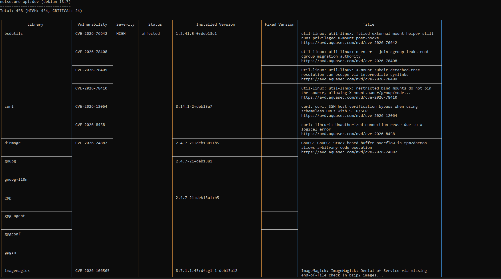
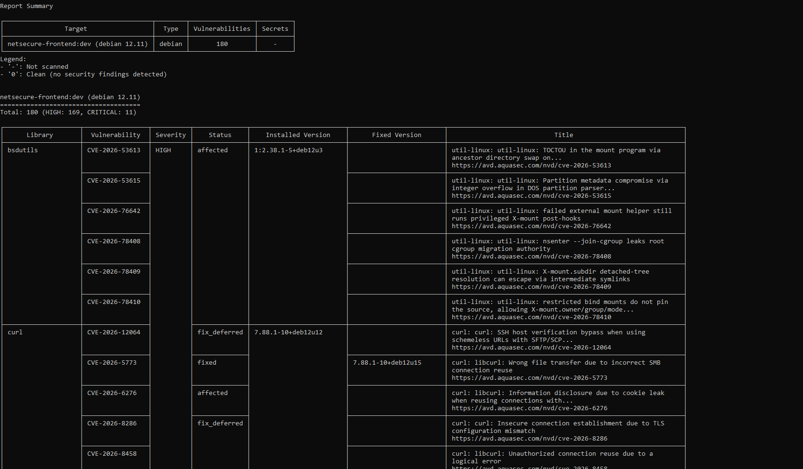
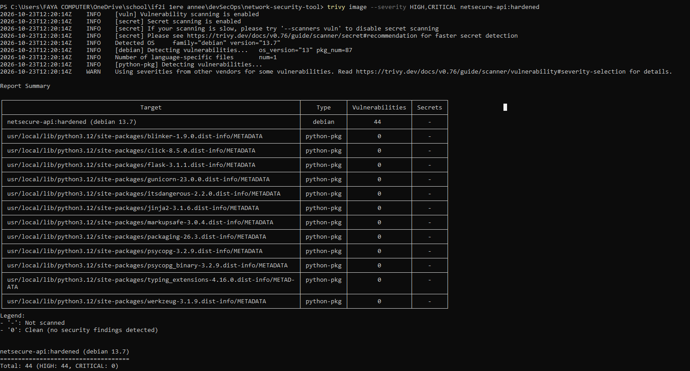
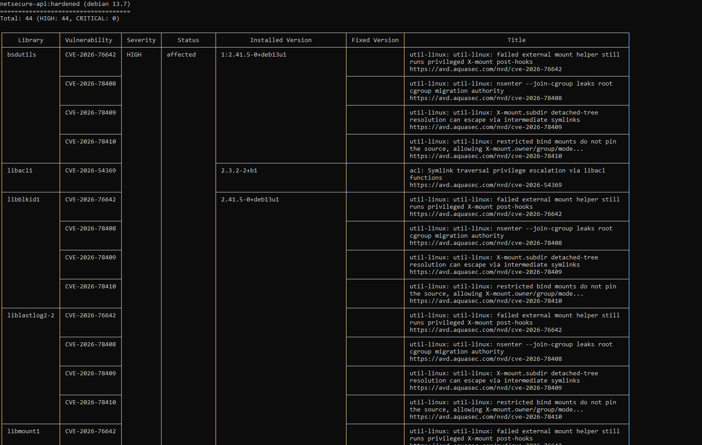
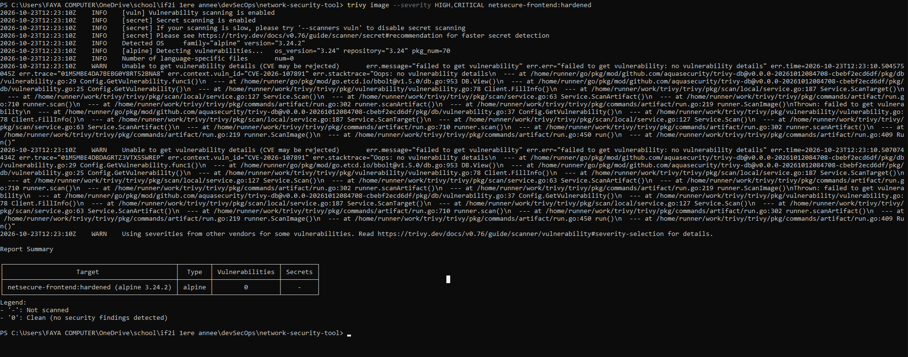
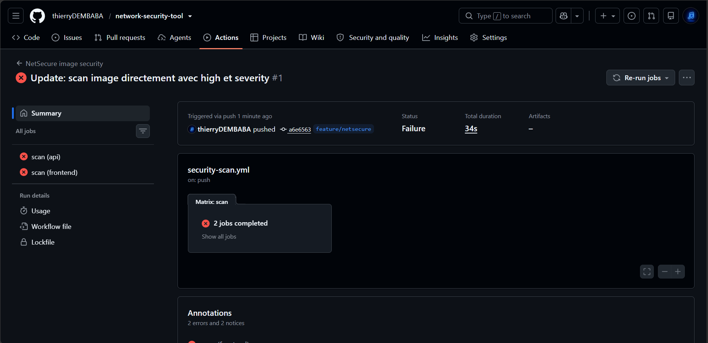
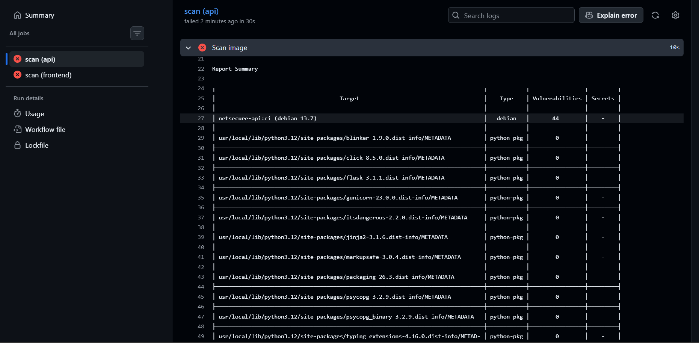
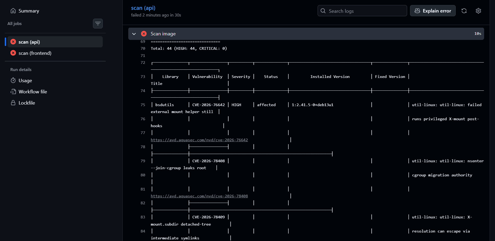

# TP 3 — NetSecure : audit de sécurité Docker avec Trivy

Outil utilisé : **Trivy 0.76.1**, lancé via son image Docker officielle (version épinglée) :

```bash
docker run --rm -v //var/run/docker.sock:/var/run/docker.sock -v trivy-cache:/root/.cache/ \
  aquasec/trivy:0.76.1 image --severity HIGH,CRITICAL <image>
```

## Partie 1 — Reconnaissance de l'infrastructure (état initial)

| Service | Image | Réseaux | Port publié sur l'hôte | Variables d'environnement |
|---|---|---|---|---|
| `frontend` | `nginx:1.27` | `frontend` | `0.0.0.0:8080 → 80` | — |
| `api` | `python:3.12` (Flask + Gunicorn) | `frontend`, `backend` | `0.0.0.0:5000 → 5000` | `.env` (identifiants BD), `DB_HOST`, `TARGETS` |
| `db` | `postgres:16` | `backend` | `0.0.0.0:5432 → 5432` | `.env` (`POSTGRES_DB`, `POSTGRES_USER`, `POSTGRES_PASSWORD`) |

Volume : `db-data` (données PostgreSQL). Réseaux : `netsecure_frontend` et `netsecure_backend` (bridge).

**Constats :**
- Seul le **frontend** doit être accessible depuis l'hôte : c'est l'unique point d'entrée. Nginx relaie `/api/` vers l'API par le réseau Docker.
- L'**API** était publiée sur `0.0.0.0:5000`. Elle était donc joignable directement, en contournant Nginx. Preuve : `http://localhost:5000/` renvoyait un 404 *Flask*.
- La **base de données exposait inutilement son port 5432** sur toutes les interfaces de l'hôte, donc sur le réseau local, alors que seule l'API a besoin de la joindre.
- Les secrets ne sont pas dans Git : `.env` est ignoré, et seul `.env.example` est versionné.

## Partie 2 — Scan des images (avant durcissement)

| Image | OS | CRITICAL | HIGH | Total | Taille |
|---|---|---|---|---|---|
| `netsecure-api:dev` (`python:3.12`) | Debian 13.7 | **24** | **434** | **458** | 1,66 Go |
| `netsecure-frontend:dev` (`nginx:1.27`) | Debian 12.11 | 11 | 169 | 180 | 282 Mo |
| `postgres:16` | Debian 13.7 | 2 | 86 | 88 | 642 Mo |





Extrait complet : [docs/trivy/api-avant.txt](docs/trivy/api-avant.txt)

**Trois résultats significatifs (API) :**

| Composant | Version installée | Sévérité | CVE | Version corrigée |
|---|---|---|---|---|
| `libmariadb-dev` | 1:11.8.6-0+deb13u1 | CRITICAL | CVE-2026-49261 (exécution de code arbitraire via `wsrep_notify_cmd`) | aucune (*affected*) |
| `openssh-client` | 1:10.0p1-7+deb13u4 | CRITICAL | CVE-2026-60002 (use-after-free lors du ré-échange de clé d'hôte) | aucune (*affected*) |
| `curl` | 8.14.1-2+deb13u7 | HIGH | CVE-2026-12064 (contournement de la vérification de l'hôte SSH) | aucune (*affected*) |

**Analyse :**
- **100 % des vulnérabilités sont dans les paquets système Debian.** Les dépendances Python de l'application (Flask, Gunicorn, psycopg…) n'en ont aucune.
- Ces paquets viennent de l'image `python:3.12` « complète ». Elle embarque un environnement de compilation : clients MariaDB, ImageMagick, OpenEXR, GnuPG, openssh, en-têtes du noyau… **L'API n'utilise aucun de ces paquets.** Ils ne font qu'élargir la surface d'attaque.
- **Aucune vulnérabilité n'avait de version corrigée** au moment du scan (statuts : 443 *affected*, 12 *fix_deferred*, 3 *will_not_fix*). Mettre à jour les paquets ne suffisait donc pas : la vraie correction était de **retirer les paquets inutiles**.

## Partie 3 — Durcissement appliqué

### Dockerfile de l'API ([api/Dockerfile](api/Dockerfile))

| Mesure | Avant | Après | Pourquoi |
|---|---|---|---|
| Image de base | `python:3.12` (complète) | `python:3.12-slim` | Moins de paquets embarqués, donc moins de CVE et une surface d'attaque réduite |
| Correctifs système | aucun | `apt-get upgrade` au build | Applique les correctifs Debian disponibles |
| Utilisateur | `root` | `app` (uid 10001, sans shell) | Une compromission de l'application ne donne pas les droits root dans le conteneur |
| Outils d'installation | pip, setuptools, wheel présents | désinstallés après `pip install` | Inutiles à l'exécution. pip embarquait des copies vulnérables d'`urllib3` et `msgpack` (4 CVE HIGH corrigeables) |
| Cache / bytecode | cache pip conservé | `PIP_NO_CACHE_DIR`, `PYTHONDONTWRITEBYTECODE` | Image plus légère, compatible avec un système de fichiers en lecture seule |

### Dockerfile du frontend ([frontend/Dockerfile](frontend/Dockerfile))

| Avant | Après | Pourquoi |
|---|---|---|
| `nginx:1.27` (Debian, root, version non maintenue) | `nginxinc/nginx-unprivileged:1.30.6-alpine` | Branche stable maintenue et version épinglée. Base Alpine minimale. Exécution sous l'utilisateur `nginx` (uid 101), sur le port 8080 |
| En-tête `Server: nginx/1.27.5` | `server_tokens off` → `Server: nginx` | Ne divulgue plus la version exacte à un attaquant |

### Compose ([compose.yaml](compose.yaml))

| Mesure | Services | Effet |
|---|---|---|
| Suppression du port publié **5000** | `api` | API joignable uniquement par Nginx, via le réseau Docker |
| Suppression du port publié **5432** | `db` | Base joignable uniquement par l'API, via le réseau `backend` |
| Frontend publié sur `127.0.0.1:8080` au lieu de `0.0.0.0` | `frontend` | Accessible depuis la machine seulement, pas depuis le réseau local |
| Réseau `backend` en `internal: true` | `db`, `api` | Le réseau de la base n'a aucune route vers Internet |
| `read_only: true` + `tmpfs: /tmp` | `api`, `frontend` | Système de fichiers en lecture seule : un attaquant ne peut ni modifier le code ni déposer un binaire |
| `cap_drop: ALL` | tous | Retire toutes les capacités Linux. La base ne récupère que les 5 capacités dont son entrypoint a besoin (`CHOWN`, `DAC_OVERRIDE`, `FOWNER`, `SETGID`, `SETUID`) |
| `no-new-privileges:true` | tous | Empêche toute élévation de privilèges (binaires setuid, etc.) |
| `postgres:16` → `postgres:16-alpine` | `db` | Image plus légère : 88 → 26 vulnérabilités HIGH/CRITICAL |
| Healthcheck de l'API + `depends_on: service_healthy` | `api`, `frontend` | Démarrage ordonné : Nginx attend que l'API réponde |

### Comparaison avant / après

| Image | CRITICAL | HIGH | Corrigeables | Taille |
|---|---|---|---|---|
| API avant (`netsecure-api:dev`) | 24 | 434 | 0 | 1,66 Go |
| **API après (`netsecure-api:hardened`)** | **0** | **44** | **0** | **212 Mo** |
| Frontend avant (`nginx:1.27`) | 11 | 169 | 87 | 282 Mo |
| **Frontend après (`netsecure-frontend:hardened`)** | **0** | **0** | — | **90 Mo** |
| Base avant (`postgres:16`) | 2 | 86 | 26 | 642 Mo |
| Base après (`postgres:16-alpine`) | 1 | 25 | 26 | 420 Mo |

Extraits : [docs/trivy/api-apres.txt](docs/trivy/api-apres.txt), [docs/trivy/frontend-apres.txt](docs/trivy/frontend-apres.txt)

**API après durcissement : 44 HIGH, 0 CRITICAL** (Debian 13.7, 87 paquets système au lieu de 469)




**Frontend après durcissement : 0 vulnérabilité HIGH/CRITICAL** (Alpine 3.24.2, 70 paquets)



Pendant ce scan, Trivy affiche deux avertissements `Unable to get vulnerability details` pour `CVE-2026-107891`. Ce n'est pas une erreur du scan : la CVE est référencée par la base Alpine, mais ses détails sont absents de la base Trivy (CVE en cours de publication ou rejetée). Trivy ne peut donc pas lui attribuer de sévérité, et elle n'apparaît pas dans le filtre HIGH/CRITICAL.

**Les 44 HIGH restantes sur l'API** concernent des paquets du socle Debian minimal (`util-linux`, `ncurses`, `systemd` libs, `perl-base`, `libacl1`), présents même dans l'image *slim*. **Aucune n'a de correctif disponible** : on ne peut pas les corriger aujourd'hui, seulement les surveiller. Pour aller plus loin, il faudrait une image *distroless* ou construite *from scratch*, qui ne contient ni shell ni utilitaires système.

### Vérification fonctionnelle

| Test | Résultat |
|---|---|
| `http://localhost:8080` (interface) | ✅ 200, l'interface fonctionne |
| `localhost:8080/api/health` (via Nginx) | ✅ `{"database":"up","status":"ok"}` |
| `POST /api/checks` (API → BD, API → services) | ✅ 201, résultats enregistrés, historique conservé |
| `localhost:5000` / `localhost:5432` depuis l'hôte | ❌ plus aucun conteneur publié sur ces ports |
| Utilisateur dans les conteneurs | `api` : `uid=10001(app)` ; `frontend` : `uid=101(nginx)` |
| Écriture dans `/app` (API) ou `/etc/nginx` (frontend) | ❌ `Read-only file system` |
| Capacités effectives de l'API | `CapEff: 0000000000000000` (aucune) |
| Accès Internet depuis `db` (réseau `backend`) | ❌ aucune résolution DNS externe |

## Partie 4 — Contrôle Trivy dans le pipeline CI

Workflow : [.github/workflows/security-scan.yml](.github/workflows/security-scan.yml), déclenché à chaque `push` et `pull_request`.

### Fonctionnement

Un job `scan` est lancé pour chaque service (matrice `api` / `frontend`, `fail-fast: false`) :

| Étape | Rôle |
|---|---|
| `Checkout repository` | `actions/checkout` épinglée sur le **SHA de commit** de la v7.0.1, et non sur un tag qu'on peut déplacer |
| `Build … image` | `docker build -t netsecure-<service>:ci ./<service>` |
| `Install Trivy` | Téléchargement de la **release officielle 0.76.1** (version fixée), puis **vérification de l'empreinte SHA-256** publiée dans `trivy_0.76.1_checksums.txt` avant extraction. Si l'archive a été altérée, `sha256sum --check` échoue et le job s'arrête. |
| `Scan image` | `trivy image --exit-code 1 --severity HIGH,CRITICAL netsecure-api:ci` : échoue dès qu'une vulnérabilité HIGH ou CRITICAL est trouvée |

La permission `contents: read` applique le principe du moindre privilège.

### Résultat observé (run #1, commit `a6e6563`, push sur `feature/netsecure`)



| Job | Étape en échec | Cause | Code de sortie |
|---|---|---|---|
| `scan (api)` | `Scan image` | Trivy trouve **44 vulnérabilités HIGH** (0 CRITICAL) dans `netsecure-api:ci` | 1 |
| `scan (frontend)` | `Scan image` | La commande scanne `netsecure-api:ci`, alors que ce job n'a construit que `netsecure-frontend:ci`. Trivy ne trouve l'image ni dans Docker ni sur Docker Hub : `unable to find the specified image "netsecure-api:ci"` | 1 |




Le résultat de la CI est **identique au scan local** de `netsecure-api:hardened` (44 HIGH, 0 CRITICAL, Debian 13.7). Le scan est donc reproductible.

**Correction à apporter au job `frontend`** : chaque job de la matrice doit scanner l'image qu'il vient de construire, avec `netsecure-${{ matrix.service }}:ci` au lieu de `netsecure-api:ci`. En local, `netsecure-frontend:hardened` ne contient aucune vulnérabilité HIGH/CRITICAL : une fois cette correction faite, le job frontend passerait au vert.

### Pourquoi un scan en échec bloque la suite du pipeline

Quand Trivy trouve une vulnérabilité au niveau demandé, `--exit-code 1` le fait **terminer avec le code 1**, au lieu de 0 par défaut. GitHub Actions considère alors l'étape en échec :
- les étapes suivantes du job ne sont pas exécutées (par exemple une étape de publication de l'image dans un registre, ou de déploiement) ;
- le job, puis le run, passent au rouge ❌ ;
- sur une Pull Request, le check échoue. Avec une règle de protection de branche (*Require status checks to pass before merging*), le merge vers `main` devient impossible.

C'est ce qui transforme le scan en **barrière de sécurité** (*security gate*) : une image vulnérable ne peut pas être intégrée ni livrée sans décision explicite.

### Limite de cette politique et amélioration proposée

Les 44 HIGH restantes de l'API **n'ont aucun correctif disponible** (statut `affected`, colonne *Fixed Version* vide). Avec `--exit-code 1 --severity HIGH,CRITICAL`, le pipeline restera donc **rouge en permanence**, même si l'équipe ne peut rien corriger. Le risque : que le pipeline finisse par être ignoré, ou désactivé.

Une politique plus exploitable, préparée en commentaire dans le workflow, sépare trois étapes :

| Étape | Commande | Rôle |
|---|---|---|
| Rapport | `--severity HIGH,CRITICAL --exit-code 0` | Tout afficher, sans bloquer |
| Barrière 1 | `--severity CRITICAL --exit-code 1` | Aucune CRITICAL tolérée, corrigeable ou non |
| Barrière 2 | `--severity HIGH --ignore-unfixed --exit-code 1` | Bloquer toute HIGH pour laquelle un correctif existe |

Simulation en local avec ces commandes :

| Image | Barrière CRITICAL | Barrière HIGH corrigeables | Pipeline |
|---|---|---|---|
| `netsecure-api:hardened` | exit 0 | exit 0 | ✅ |
| `netsecure-frontend:hardened` | exit 0 | exit 0 | ✅ |
| `netsecure-api:dev` (image d'avant durcissement) | **exit 1** (24 CRITICAL) | exit 0 | ❌ |

Cette politique **bloque l'image initiale** et **accepte l'image durcie**, tout en laissant visibles les HIGH non corrigées, pour qu'elles soient surveillées.

## Partie 5 — Questions d'analyse

### Q1. Différence entre scanner le code source et scanner une image Docker

- **Scanner le code source (SAST)**, avec Bandit par exemple (TP 2), analyse **le code écrit par l'équipe** : injections, `eval`, secrets en dur, mauvaises pratiques. Il ne voit ni le système d'exploitation, ni les bibliothèques installées.
- **Scanner une image Docker**, avec Trivy, analyse **tout ce qui sera réellement exécuté** : les paquets du système de base (Debian, Alpine), les bibliothèques installées par `pip` et leurs versions exactes, et éventuellement des secrets oubliés dans les couches. Il compare ces versions aux bases de CVE connues.

Ici, le code de l'API ne présentait aucun problème, et ses dépendances Python aucune CVE. Pourtant, l'image initiale contenait 458 vulnérabilités, toutes dans les paquets système. Seul le scan d'image pouvait les détecter. Les deux contrôles sont complémentaires.

### Q2. Différence entre un port exposé et un port publié sur l'hôte

- **Port exposé** (`EXPOSE` dans le Dockerfile, `expose:` dans Compose) : c'est de la **documentation**. Il indique sur quel port le service écoute, et le service reste joignable **uniquement par les autres conteneurs du même réseau Docker** (par exemple `api:5000` depuis Nginx). Rien n'est ouvert sur la machine hôte.
- **Port publié** (`ports: "8080:8080"`, ou `-p`) : Docker crée une **redirection depuis un port de l'hôte** vers le conteneur. Le service devient joignable depuis la machine, et même depuis le réseau local si l'adresse d'écoute est `0.0.0.0`.

Dans NetSecure, seul le frontend est publié (`127.0.0.1:8080`). L'API (5000) et la base (5432) sont seulement exposées. `docker compose ps` affiche `5000/tcp` pour un port exposé, et `0.0.0.0:5000->5000/tcp` pour un port publié.

### Q3. Pourquoi isoler une base de données sur le réseau backend

- **Réduire la surface d'attaque** : seule l'API a besoin de la base. Le frontend, qui est exposé, n'a aucune route vers elle. Si Nginx est compromis, l'attaquant ne peut pas joindre PostgreSQL directement.
- **Segmentation et défense en profondeur** : pour atteindre les données, un attaquant doit compromettre successivement le frontend, puis l'API. C'est le même principe qu'une DMZ.
- **Aucune exposition externe** : sans port publié, la base n'est joignable ni depuis l'hôte, ni depuis le réseau local. Cela empêche les attaques par force brute sur le mot de passe, ou l'exploitation directe d'une CVE de PostgreSQL.
- **Pas de sortie vers Internet** (`internal: true`) : même compromise, la base ne peut pas exfiltrer de données ni télécharger d'outils.

### Q4. Quel risque présente un conteneur exécuté en root

Par défaut, l'utilisateur `root` du conteneur est **le même uid 0 que le root de l'hôte**. Seules les isolations du noyau (namespaces, capacités, seccomp) l'en séparent. Si l'application est compromise, par exemple par une RCE dans une dépendance :
- l'attaquant a **tous les droits dans le conteneur** : il peut modifier le code, installer des outils, lire tous les fichiers et secrets montés ;
- une **évasion de conteneur** (faille du noyau ou du runtime, volume sensible monté, `docker.sock` partagé, mode `--privileged`) lui donne **directement root sur l'hôte** ;
- il dispose de capacités Linux étendues (`CHOWN`, `NET_RAW`…), utiles pour attaquer le réseau interne.

C'est pourquoi l'API tourne sous `app` (uid 10001) et Nginx sous `nginx` (uid 101), avec `cap_drop: ALL`, `no-new-privileges` et un système de fichiers en lecture seule.

### Q5. Que signifient HIGH, CRITICAL, CVE et version corrigée

- **CVE** (*Common Vulnerabilities and Exposures*) : un **identifiant unique** attribué à une vulnérabilité publique (par exemple `CVE-2026-49261`). Il permet à tous les outils et éditeurs de parler de la même faille.
- **HIGH / CRITICAL** : des **niveaux de gravité**, généralement issus du score **CVSS** (0 à 10) :
  - **CRITICAL** (9,0 à 10) : exploitable à distance, souvent sans authentification, avec un impact majeur (exécution de code, prise de contrôle) ;
  - **HIGH** (7,0 à 8,9) : impact important, mais avec des conditions d'exploitation plus restrictives (accès local, interaction de l'utilisateur…).

  Viennent ensuite MEDIUM, LOW et UNKNOWN.
- **Version corrigée** (*Fixed Version*) : la **première version du paquet qui corrige la faille**. Si elle est indiquée, il suffit de mettre à jour. Si elle est vide (statut `affected`, `fix_deferred` ou `will_not_fix`), aucun correctif n'est disponible pour cette distribution : il faut retirer le composant, changer d'image, ou accepter le risque et le surveiller.

### Q6. Que fait `--exit-code 1` et pourquoi l'utiliser en CI

Par défaut, Trivy **termine toujours avec le code 0**, même s'il trouve des vulnérabilités : il se contente de les afficher. Avec `--exit-code 1`, il termine avec le **code 1 dès qu'il trouve une vulnérabilité au niveau de sévérité demandé**.

En CI, c'est indispensable, car un pipeline ne lit pas les rapports : **il ne regarde que les codes de sortie**. Sans cette option, le job resterait vert quel que soit le résultat, et le scan serait purement décoratif. Avec elle, le scan devient une **barrière automatique** : l'étape échoue, le pipeline s'arrête, et la Pull Request est bloquée. C'est ce qu'on a observé : 44 HIGH, donc exit 1, donc job rouge.

### Q7. Pourquoi une image sans CVE détectée n'est pas nécessairement sûre

- **Trivy ne connaît que les vulnérabilités publiées** : les failles *zero-day*, ou celles pas encore référencées, sont invisibles (exemple : l'avertissement `CVE-2026-107891`, sans détails, dans notre scan du frontend).
- **Il ne voit pas les failles de l'application elle-même** : injection SQL, contrôle d'accès absent, logique métier défaillante. C'est le rôle du SAST, du DAST et de la revue de code.
- **Il ne voit pas la configuration d'exécution** : une image « propre » lancée en `--privileged`, en root, avec des ports publiés inutilement ou des secrets en clair dans les variables reste dangereuse.
- **Le résultat est daté** : une image saine aujourd'hui peut avoir des CVE critiques demain, quand de nouvelles failles sont publiées.
- **La détection a des limites** : binaires copiés à la main, dépendances embarquées dans d'autres paquets, distributions mal reconnues… Certains composants peuvent échapper à l'inventaire.

« 0 CVE détectée » signifie « aucune vulnérabilité **connue** dans les composants **identifiés** ». Ce n'est pas la même chose que « sûr ».

### Q8. Quels risques subsistent après la mise à jour des dépendances

- **Les vulnérabilités sans correctif** : nos 44 HIGH restent présentes tant que Debian ne publie pas de correctif.
- **Les régressions** : une nouvelle version peut casser l'application, ou changer un comportement (API modifiée, configuration par défaut différente). D'où l'importance des tests en CI.
- **Les nouvelles vulnérabilités** introduites par la nouvelle version elle-même.
- **Les attaques de la chaîne d'approvisionnement** : un paquet ou une image compromise à la source, une action GitHub modifiée, un *typosquatting*. Pour limiter ce risque : épingler les versions, vérifier les empreintes (comme pour Trivy) et épingler les actions par SHA.
- **Les failles du code applicatif et de la configuration**, que la mise à jour des dépendances ne corrige pas.
- **Les dépendances transitives** : une bibliothèque à jour peut tirer une sous-dépendance vulnérable.
- **La dérive dans le temps** : sans scan régulier, l'image vieillit et redevient vulnérable. Il faut reconstruire et rescanner périodiquement, pas seulement lors d'un push.

## Livrables

| Livrable | Lien / fichier |
|---|---|
| Dépôt NetSecure | https://github.com/thierryDEMBABA/network-security-tool (branche `feature/netsecure`) |
| Dockerfiles mis à jour | [api/Dockerfile](api/Dockerfile), [frontend/Dockerfile](frontend/Dockerfile) (+ [frontend/nginx.conf](frontend/nginx.conf)) |
| Compose mis à jour | [compose.yaml](compose.yaml) |
| Fichier workflow | [.github/workflows/security-scan.yml](.github/workflows/security-scan.yml) |
| Résultats Trivy avant | [trivy-api-avant-resume.png](assets/img/trivy-api-avant-resume.png), [trivy-api-avant-detail.png](assets/img/trivy-api-avant-detail.png), [trivy-frontend-avant.png](assets/img/trivy-frontend-avant.png), [docs/trivy/api-avant.txt](docs/trivy/api-avant.txt) |
| Résultats Trivy après | [trivy-api-apres-resume.png](assets/img/trivy-api-apres-resume.png), [trivy-api-apres-detail.png](assets/img/trivy-api-apres-detail.png), [trivy-frontend-apres.png](assets/img/trivy-frontend-apres.png), [docs/trivy/api-apres.txt](docs/trivy/api-apres.txt), [docs/trivy/frontend-apres.txt](docs/trivy/frontend-apres.txt) |
| Résultats du pipeline CI | [ci-trivy-run-echec.png](assets/img/ci-trivy-run-echec.png), [ci-trivy-api-resume.png](assets/img/ci-trivy-api-resume.png), [ci-trivy-api-detail.png](assets/img/ci-trivy-api-detail.png) |
| Analyse des changements | Partie 3 de ce document |
| Réponses aux huit questions | Partie 5 de ce document |

Aucun mot de passe ni jeton n'est versionné : les identifiants de la base sont dans `.env`, ignoré par Git. Seul [.env.example](.env.example), avec des valeurs factices, est publié.
